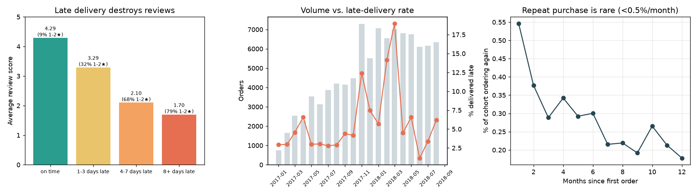

# Olist ELT pipeline: contract-checked lake → Postgres → dbt star schema, orchestrated by Airflow

A batch data platform for the [Olist Brazilian e-commerce dataset](https://www.kaggle.com/datasets/olistbr/brazilian-ecommerce)
(~100k orders, 9 source files, 1.5M rows). It treats the static Kaggle export as if it were a live feed: Airflow **replays
history one month at a time**, loads each month incrementally, and dbt builds a tested star schema plus analytics marts on top.

```
 Kaggle CSVs ──► LANDING ──► BRONZE ──────────► SILVER ───────────► POSTGRES raw ──► dbt ──────────────────────────────►
                 data/       immutable copy     typed parquet,       COPY-loaded,      staging (9 views)
                 landing     + sha256 manifest  data contracts,      _batch_id,        → intermediate (ephemeral)
                             (idempotent)       quarantine + DQ      _loaded_at,       → core: fct_orders, fct_order_items (incremental),
                                                report               load audit           dim_customers/sellers/products/date
                                                                                       → analytics: delivery, sellers, cohorts, RFM
                                                                                       → snapshot: SCD2 product history
 └──────────────────────────── Airflow: olist_monthly_replay (26 monthly runs) / olist_full_refresh ────────────────────┘
```

## Highlights

| Area | What it does |
|---|---|
| **Ingestion** | Bronze keeps every file version with a sha256 manifest; re-running skips unchanged files (idempotent). |
| **Data contracts** | Each source has a declared schema, primary key, required columns and allowed values (`olist_pipeline/contracts.py`). Violations are **quarantined and counted**, never silently dropped. |
| **Fast loads** | Postgres `COPY` instead of the original row-by-row `INSERT`: full load of 1.2M rows in ~27 s. |
| **Incremental + idempotent** | `load --mode month` upserts one month's orders and their children (delete-by-order_id + insert). dbt `fct_orders` / `fct_order_items` are incremental (`delete+insert` on `_loaded_at`). Re-running a month changes nothing. |
| **Modelling** | Star schema at the right grain: one row per order, per order line, per *real* customer. |
| **Testing** | 57 dbt tests: keys, relationships, accepted values/ranges, an **enforced model contract** on `fct_orders`, and reconciliation tests (payments vs order value, timeline order). 13 pytest unit tests for the Python layer. |
| **Orchestration** | Airflow 2.10 (LocalExecutor) in Docker; dbt runs in its own virtualenv inside the image to avoid dependency conflicts. |
| **CI** | GitHub Actions spins up Postgres, runs unit tests, ingests a committed 400-order fixture, runs `dbt build`, then checks an incremental re-run. |

## Data issues this pipeline found (and how it handles them)

1. **`customer_id` is not a customer.** Olist issues a new `customer_id` for every order; the person is `customer_unique_id`.
   The original project built `dim_customers` on `customer_id` (99,441 "customers"). Here `dim_customers` is keyed on
   `customer_unique_id` → **96,096 real customers, only 3.1% buy more than once**, which is why RFM uses bucketed frequency.
2. **Geolocation is 26% duplicates** (1,000,163 → 738,332 rows in silver) and contains points outside Brazil; staging
   averages to one point per zip prefix inside Brazil's bounding box.
3. **166 orders were handed to the carrier *before* they were purchased** (median 36 min early → clock skew; worst 171 days).
   A hard "delivered before purchase" rule stays an error (0 rows); the carrier anomaly is kept, flagged
   (`fct_orders.has_timeline_anomaly`) and monitored by a warn-level test that fails if it grows past 500.
4. **169 delivered orders don't reconcile** (payments ≠ items + freight by > R$5) — instalment interest / vouchers.
   Monitored as a warning with an error threshold.
5. `review_id` is **not unique** in the source; the contract keys reviews on `(review_id, order_id)` and staging keeps the
   latest review per order.

## Results from the warehouse



| Metric | Value |
|---|---|
| Orders / order lines / real customers | 99,441 / 112,650 / 96,096 |
| Monthly replay | 26 Airflow runs (Sep 2016 → Oct 2018); final tables match a full load row for row |
| Average delivery time vs. promise | 12.6 days delivered vs. 23.7 days promised |
| Delivered late | 6.8% of delivered orders |
| Review score on time → 8+ days late | **4.29 → 1.70** (1-2★ share 9% → 79%) |
| Worst states for lateness | MA 17.4%, CE 13.7%, BA 12.2%, RJ 12.1% |
| Repeat purchase | < 0.6% of a cohort orders again in any month after the first |
| dbt | 20 models, 1 snapshot, 57 tests; 2 deliberate warnings (issues 3 and 4 above) |

**So what?** Olist promises roughly twice the real delivery time, yet the 6.8% of orders that still arrive late account for most of
the 1-2★ reviews. Lateness is concentrated in the North-East (MA, CE, BA) and Rio, so the clearest levers are routing and
seller hand-off for those lanes, not generic marketing. With repeat purchase this rare, acquisition economics dominate.

Charts are regenerated from the marts with `python -m olist_pipeline.report`.

## Run it

Prerequisites: Docker Desktop, Python 3.11+, the Kaggle zip.

```bash
# 1. put the 9 Olist CSVs in data/landing/
# 2. start Postgres + Airflow (own project name and ports, won't clash with other stacks)
docker compose up -d --build
# 3. open http://localhost:8089 (admin/admin), unpause `olist_monthly_replay`
#    -> Airflow backfills Sep 2016 ... Oct 2018, one month per run
```

Or run the steps by hand:

```bash
python -m venv .venv && .venv\Scripts\activate      # source .venv/bin/activate on macOS/Linux
pip install -r requirements.txt
python -m olist_pipeline.cli land
python -m olist_pipeline.cli silver
python -m olist_pipeline.cli load --mode full        # or: --mode month --month 2017-11
cd dbt && dbt deps --profiles-dir . && dbt build --profiles-dir .
dbt docs generate --profiles-dir . && dbt docs serve --profiles-dir . --port 8090
cd .. && python -m olist_pipeline.report             # charts in docs/img
pytest -q
```

## Repository layout

```
olist_pipeline/      contracts.py · lake.py (land, silver, quarantine) · warehouse.py (COPY, month upserts) · cli.py · report.py
airflow/dags/        olist_dags.py: olist_monthly_replay, olist_full_refresh
dbt/models/          staging/ · intermediate/ · marts/core/ · marts/analytics/
dbt/tests/           reconciliation + timeline singular tests
dbt/snapshots/       snap_products (SCD type 2)
docker/              Airflow image (dbt in its own venv) + Postgres init
tests/               pytest unit tests + 400-order fixture used by CI
.github/workflows/   ci.yml
```

## Acknowledgements

Started from [dilambestall/order-to-delivery-analytics-pipeline](https://github.com/dilambestall/order-to-delivery-analytics-pipeline) (MIT),
which had a Python CSV→parquet→Postgres flow and five dbt models. This version replaces the ingestion layer (contracts,
quarantine, checksummed bronze, COPY, incremental month loads), rebuilds the dbt project (9 staging models, incremental facts,
customer grain fix, analytics marts, snapshot, contract and reconciliation tests), containerises Airflow, and adds CI.
Data: Olist, CC BY-NC-SA 4.0; `tests/fixtures/` holds a 400-order sample for CI.
